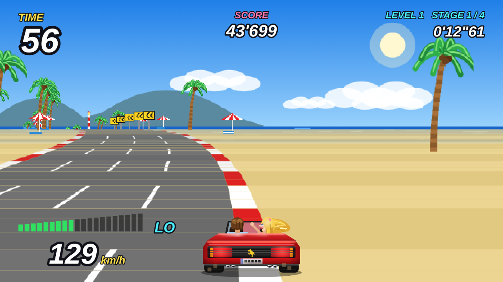

# Turbo Riviera

An original 90s-style arcade road racer for LG webOS TVs: a red convertible, a pseudo-3D road with
curves and hills, traffic, a countdown timer and forks that let you choose your route through a 4-stage route tree (Fermo, Macerata, Ancona, Ascoli Piceno, Pesaro Urbino), repeated over 4 levels with puddles and more traffic from level 2.
Name, graphics and music are original (no Sega assets). Road signs show towns and
provinces of the Fermo area (Marche, Italy).

## Controls
| Key | Action |
|---|---|
| ◀ ▶ | steer |
| ▼ | tap for 1/3 s: cut the throttle and hold speed; keep pressed: brake |
| ▲ | throttle on (a single tap is enough, it stays on) |
| OK | gear LO / HI (manual mode) |
| Red | change radio station |
| Green | audio on/off |
| Yellow | auto / manual throttle |
| Back | pause |

## Install
Download the `.ipk` from the [dist](dist) folder and install it with webOS Dev Manager or `ares-install`.
To build it yourself: `ares-package app`.

## AI disclosure
Turbo Riviera was designed by the author: concept, game rules, route forks and the 15 stages,
the Fermo-area setting with local towns and businesses, and the remote-control layout.
The code was developed with the help of an AI assistant (Claude): the author wrote and modified
parts of the code by hand and reviewed all of the AI-generated code. Graphics and music were
generated with the AI assistant following the author's direction.
The author tested every version on an LG webOS monitor (27TQ615S), found the bugs and directed the fixes.

## License
Open source under **CC BY-NC 4.0**: free to use, share and modify with credit to the author, but it may not be sold or used commercially. Codice libero, ma vietata la vendita. See [LICENSE](LICENSE).
